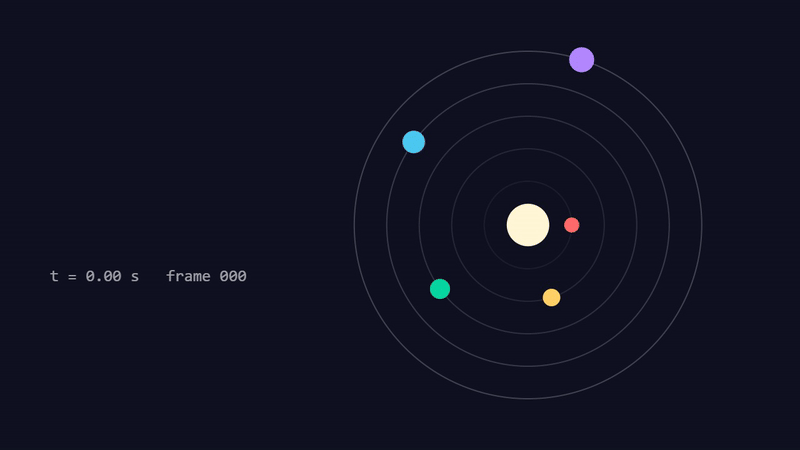

<div align="center">

# html2mp4

**Turn the HTML animation your coding agent just wrote into an MP4 or GIF, frame-exact.**

Agent video skills like code-video-showcase and Claude Video 2.0 draw every frame in HTML. This is the one-file renderer for both, with no Playwright, no Puppeteer and no `npm install`.

Works with **Claude Code** and **Codex**.

 



</div>

## Quick start
```bash
git clone https://github.com/Dodai0419/html2mp4 && cd html2mp4
node html2mp4.mjs examples/orbit.html -o orbit.mp4
```
```
C:\...\html2mp4\orbit.mp4  120 frames @30fps  1280x720  [timeline]  33.7s
```
You need Node 22+ (for its built-in WebSocket), ffmpeg, and Chrome, Edge or Chromium already installed. Nothing else.

## Gallery

| Page | Command | Result |
|------|---------|--------|
| [`examples/orbit.html`](examples/orbit.html): canvas scene, timeline contract, 4 s | `node html2mp4.mjs examples/orbit.html -o orbit.gif` |  |
| [`examples/title-card.html`](examples/title-card.html): beat-synced big card, `renderFrame` contract, 2 s | `node html2mp4.mjs examples/title-card.html -o card.mp4` |  |
| the same card, four stills | `node html2mp4.mjs examples/title-card.html --still 0.05,0.3,0.6,1.5 -o stills/x` |  |

Every picture above is a real output of the command next to it (GIFs re-encoded smaller for this page).

## The problem
- Agent video skills ask you to `npm i playwright` (plus a 150 MB browser download) or run `npx hyperframes` just to turn one HTML file into a video.
- Each skill ships its own renderer for its own page contract, so a scene written for one cannot be rendered by the other.
- Screen recording an animation drops frames; you want every frame drawn at an exact `t`.

## The solution
| Idea | Fixes |
|------|-------|
| **Talk to the browser you already have** over the DevTools protocol with Node's built-in `WebSocket` | no npm packages, no browser download |
| **Read both page contracts**: `window.renderFrame(t)` + `__ready` (code-video-showcase) and `window.__timelines[id].seek(t)` + `data-duration/width/height` (HyperFrames pages from Claude Video 2.0) | one renderer for both skills' scenes |
| **Seek, screenshot, pipe**: frame `i` is drawn at `t = i / fps`, captured as JPEG, piped straight into ffmpeg | frame-exact video, no dropped frames, no temp PNG folder |
| **MP4, GIF or stills** from the same command (`-o x.gif`, `--still 0.5,1.2`) | README GIFs and approval stills without a second tool |

## Writing a page it can render
Pick either contract. Draw the whole frame from `t` alone (no `Date.now()`, no `Math.random()` in the draw).

```html
<!-- contract 1: renderFrame (code-video-showcase) -->
<script>
  window.DURATION = 2;                       // seconds, optional
  window.renderFrame = t => { /* draw frame at t */ };
  window.__ready = true;                     // or window.__bootError = 'why'
</script>
```
```html
<!-- contract 2: timeline (HyperFrames / Claude Video 2.0) -->
<div data-composition-id="main" data-duration="4" data-width="1280" data-height="720">...</div>
<script>
  window.__timelines = { main: gsapTimeline };   // anything with .seek(t)
</script>
```
Segment mode from code-video-showcase also works: `--t0 0.35 --speed 1.4 --duration 3` appends `?seg=1&t0=0.35&speed=1.4&dur=3` to the page URL.

## Options
```
-o, --out <file>     .mp4 or .gif (required unless --still)
--duration <s>       clip length (default: the page's DURATION / data-duration, else 3)
--fps <n>            default 30
--width/--height     viewport (default: data-width/height, else 1920x1080)
--t0 <s> --speed <x> segment mode for renderFrame pages
--still <t1,t2,...>  JPEG stills instead of a video
--root <dir>         static root (default: the page's folder)
--crf <n>            libx264 quality, default 18
--quality <n>        JPEG frame quality, default 92
--demo               render the bundled examples into out/
```
Set `CHROME_EXE` to pick a browser and `FFMPEG_EXE` to pick an ffmpeg.

## Use with Claude Code
```bash
/plugin marketplace add Dodai0419/html2mp4
/plugin install html2mp4@html2mp4
```
Then: "make a 6 second launch title in HTML and render it to MP4".

## Use with Codex (ChatGPT)
```bash
git clone https://github.com/Dodai0419/html2mp4 && cp -r html2mp4/skills/* ~/.codex/skills/
```
Or copy `AGENTS.md` into your project root.

## Benchmarks
| | code-video-showcase `render-segment.mjs` | Claude Video 2.0 `render.sh` | html2mp4 |
|-|-|-|-|
| renderer | Playwright + Chromium | `npx hyperframes@0.8.181` | Node built-ins + your Chrome/Edge |
| npm packages to install | playwright (+ browser download) | hyperframes (fetched by npx) | **0** |
| lines of code | 248 (one contract) | 14 (shell wrapper; the renderer lives in the npm package) | **207 (both contracts, MP4 + GIF + stills)** |
| examples/orbit.html, 120 frames 1280x720 -> MP4 | not measured | not measured | 33-62 s (1.9-3.6 fps) |

Reproduce: `node bench/bench.mjs` (3 runs). Range covers 5 runs (bench: 48.2, 32.9, 33.7 s; two `--demo` runs: 42.4, 61.6 s), measured on Windows 11, Node 24.20, Edge headless, ffmpeg 9.0.2, with the CPU busy with other jobs, so treat it as an upper bound. Lines counted with `wc -l`. The two upstream renderers were not run here (both need packages installed from npm first), so their speed is "not measured".

## Tests
```bash
node --test
```
10 tests: both contracts render the right colour at the right frame (read back from the encoded MP4), size and duration come from `data-*`, segment params reach the page, stills, GIF, and boot errors.

## Known limits
- Audio is not muxed; add it with ffmpeg (`ffmpeg -i video.mp4 -i music.wav -c:v copy -shortest out.mp4`).
- Frames are rendered one at a time in one tab; long 4K films are slow.
- Pages that load fonts or scripts from a CDN need the network while rendering.

## Inspired by
- [Moessif/code-video-showcase](https://github.com/Moessif/code-video-showcase) (MIT): the `renderFrame` / `__ready` / segment-mode contract and the seek-screenshot-pipe-to-ffmpeg design.
- [ItsssssJack/claude-video-2](https://github.com/ItsssssJack/claude-video-2) (MIT): the one-clock `render(t)` scene rule and the HyperFrames timeline contract (`window.__timelines`, `data-composition-id`).

## Roadmap
- [ ] `--audio file.wav` to mux a soundtrack in the same pass
- [ ] render N frames in parallel tabs
- [ ] a `--loop-check` that compares frame 0 with frame N

## License
MIT
